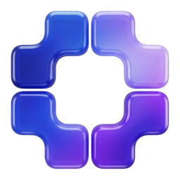
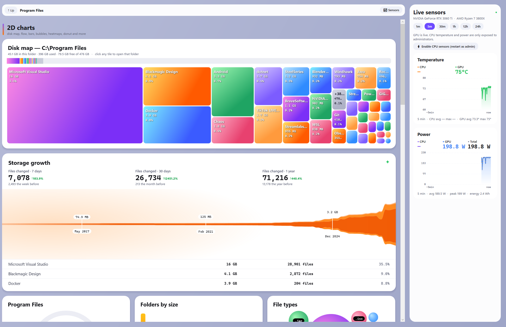
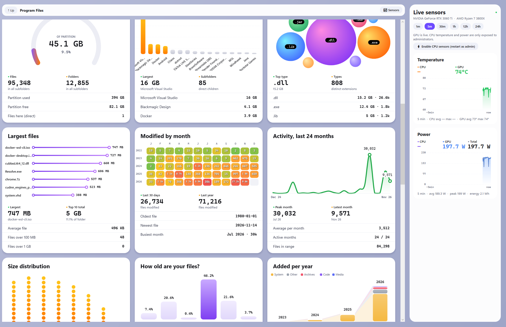
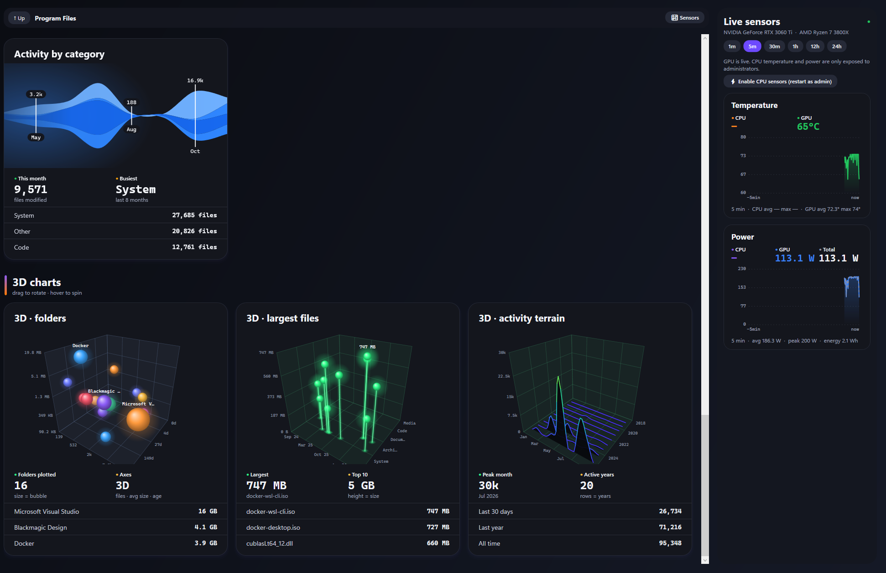

<p align="center"></p>

<h1 align="center">PartiChart</h1>

**See where your disk space went.** PartiChart is a Windows desktop app that scans a drive or folder once and turns it into a live dashboard: a map of every folder, 2D and 3D charts, the real cost of your apps and games, and live CPU / GPU temperature and power.

Everything runs locally on your PC. Nothing is uploaded and there is no telemetry.



## Download

Get the latest version from the **[Releases page](https://github.com/mightyy-duck/partichart/releases/latest)**:

| File | What it is |
|---|---|
| `PartiChart-1.0.1-x64.msi` | Installer. Adds a Start menu and desktop shortcut and can be removed from *Settings → Apps*. |
| `PartiChart-1.0.1-win-x64-portable.zip` | Single `PartiChart.exe`. Unzip anywhere and run, nothing is installed. |

**Requirements:** Windows 10 or 11, 64-bit. The .NET runtime is bundled, so there is nothing else to install.

> The files are not code-signed yet, so Windows SmartScreen may say "Windows protected your PC". Choose **More info → Run anyway**. You can compare the download against `SHA256SUMS.txt` on the release page.

## What it does

### Disk map: every folder at once
Click a partition such as `C:\` and PartiChart scans the whole drive in one pass. The **Disk map** shows every top-level folder as a tile sized by how much of the partition it uses, with a used / free bar on top. Click a tile to open that folder, which gets its own map. No more opening folders one by one.

* Fast parallel scanner (low-level directory enumeration on all cores), with live progress: each top-level folder appears as it is found, grows while it is scanned and gets a ✓ when done.
* **Fast mode** (optional, needs administrator): reads the NTFS master file table directly, the same technique used by the fastest disk-space tools, to scan a whole drive in seconds. If anything goes wrong it falls back to the normal scanner.
* Open a folder by clicking a drive, a quick-access button, *Browse…*, typing or pasting a path, dragging a folder onto the window, or passing a path on the command line.

### 2D charts
Every card shows the **current folder** and is animated; hover a card and it floats up and replays its animation.

| Chart | Shows |
|---|---|
| Disk map | Each folder as a tile, sized by its share of the partition |
| Storage growth | How usage built up over time, split by file category, with weekly / monthly / yearly change |
| Summary gauge | The folder's share of the partition, plus used and free space |
| Folders by size | The biggest sub-folders |
| File types | Which extensions use the most space (bubbles) |
| Largest files | The 10 biggest files, click one to show it in Explorer |
| Modified by month | A heatmap of the current year and the four before it |
| Activity, last 24 months | Files modified per month |
| Size distribution | How many files fall into each size range |
| How old are your files? | Share of files by age, and how much space old files use |
| Added per year | Stacked years with ribbons, split by category |
| Space by category | Media, code, documents, archives, system and other |
| Folders: files vs file size | Rounded-square bubbles: file count against average file size |
| Files over time / Activity by category | Flow charts of file count and recent activity |

### 3D charts
Three dark 3D cards (drag to rotate, hover to spin, drawn on the GPU-composited WPF pipeline):

* **3D · folders**: spheres placed by file count, average file size and age; bubble size is the folder size.
* **3D · largest files**: glowing pins placed by date and category; height is file size.
* **3D · activity terrain**: a ridge landscape of files modified by year and month.

### Apps & games storage
Click **🎮 Apps & games storage** to see every installed program and game with **the size of the program itself and the size of its data**:

* Finds apps from Steam, Epic Games, Xbox, and the Windows installed-programs list (including Ubisoft, GOG, Riot and others that register there).
* Measures the install folder, then looks for matching data in AppData, ProgramData, Documents, My Games and Saved Games.
* Each row is a split bar (program vs data) with totals; filter by *Games / Apps*, sort by *Total / Program / Data*, search by name, click a row to open its folder, hover to see the data folders found.

The data part is matched by folder name, so treat it as an estimate.

### Live sensors
The right-hand panel shows **temperature and power** and updates every second. Pick the window: **1 min, 5 min, 30 min, 1 h, 12 h or 24 h**. Each chart has hover values, average and peak, and the Power card adds the energy used in the window (Wh / kWh).

* **GPU** temperature and power work without administrator rights.
* **CPU** temperature and power are only exposed to administrators; the panel offers a one-click restart in elevated mode.
* History is kept for 24 hours (per-minute points are saved to `%AppData%\PartiChart\sensors.csv`).
* Power is CPU + GPU only, not the whole PC.

### Themes
A light and a dark theme, switchable from the sidebar and remembered between runs.





## Quick start

1. Start PartiChart.
2. Click a drive in **Partitions** (or *Browse…*, or drop a folder onto the window).
3. Wait for the scan, then click tiles and bars to dive into folders. Use **↑ Up** or the breadcrumb to go back.
4. Try **🎮 Apps & games storage**, the theme button, and the **📈 Sensors** button in the top bar.

Command line:

```text
PartiChart.exe [folder] [--dark | --light] [--apps]
```

## Privacy and what is written to disk

* Scanning, apps and sensors are all read locally. No network access, no telemetry.
* The app stores only `%AppData%\PartiChart\theme.txt` (your theme) and `%AppData%\PartiChart\sensors.csv` (24 h of sensor history).

## Known limitations

* Windows only (WPF, .NET 10).
* Fast mode (NTFS master file table) and CPU sensors need administrator rights. Fast mode is new and is skipped automatically on non-NTFS drives.
* Apps & games data sizes are matched by folder name and are estimates; Microsoft Store (UWP) apps are not listed.
* The installer and the exe are not code-signed.

## Build from source

You need the [.NET 10 SDK](https://dotnet.microsoft.com/download). See [docs/BUILD.md](docs/BUILD.md) for the full steps, including the MSI.

```powershell
dotnet run -c Release
```

## Documentation

* [User guide](docs/USER-GUIDE.md)
* [Building, publishing and the MSI](docs/BUILD.md)
* [How it works](docs/ARCHITECTURE.md)
* [Changelog](CHANGELOG.md)
* [Third-party notices](THIRD-PARTY-NOTICES.md)

## License

[MIT](LICENSE). Hardware sensors use [LibreHardwareMonitor](https://github.com/LibreHardwareMonitor/LibreHardwareMonitor) (MPL-2.0); see the third-party notices.
